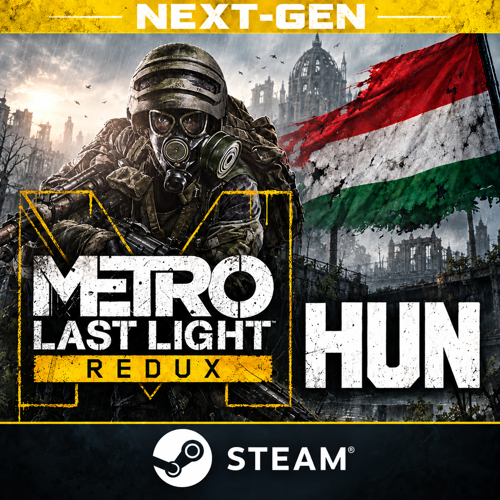
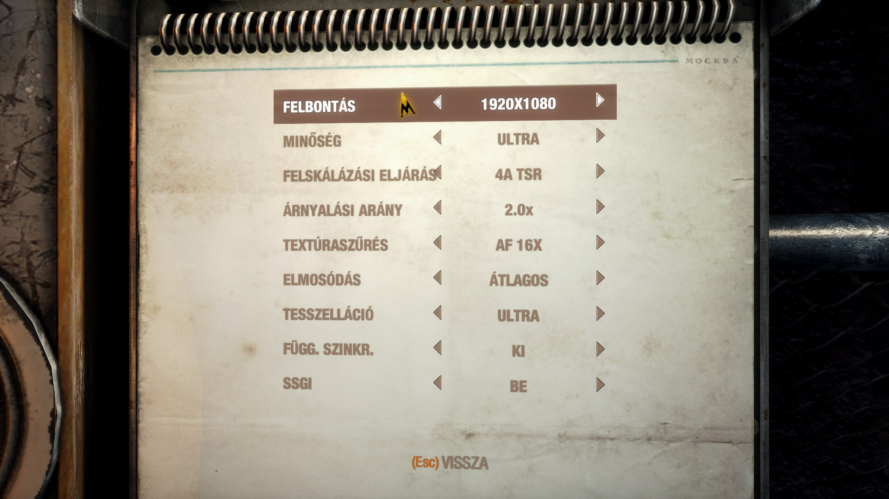
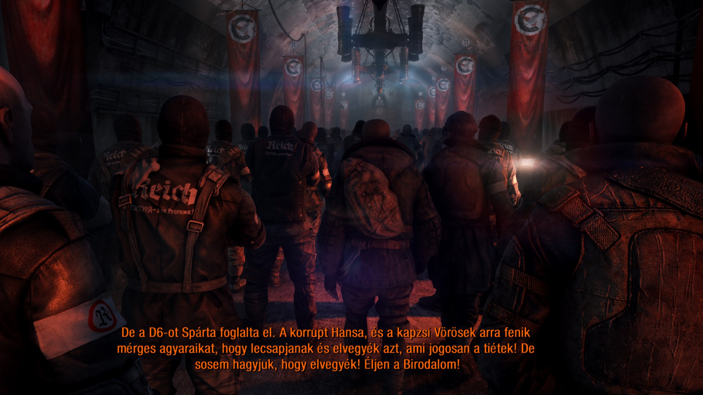
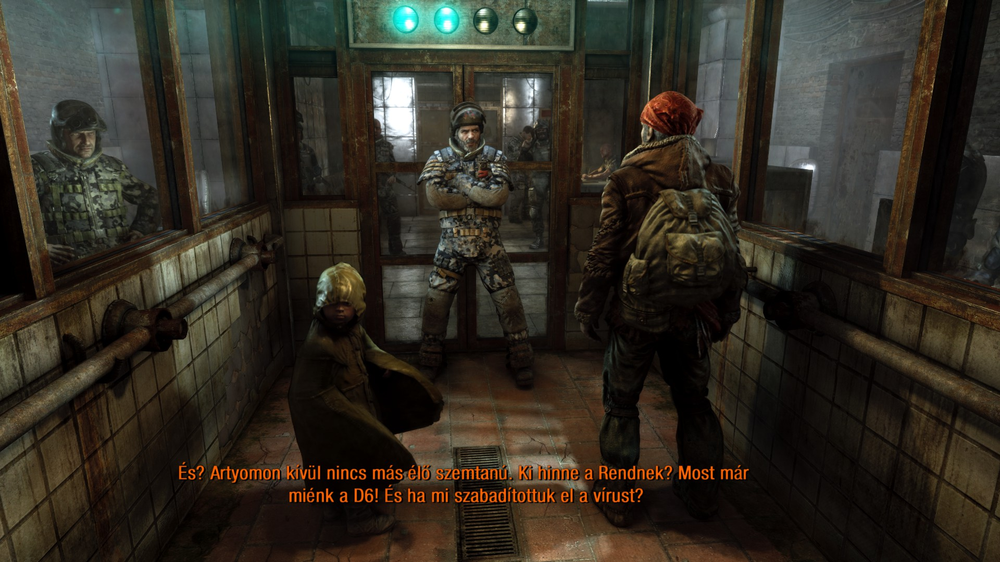

# Metro Last Light Redux Next-Gen – Magyarítás

Nem hivatalos magyarítás a **Metro Last Light Redux Steam next-gen Windows-kiadásához**. Magyar menük és feliratok, az új szövegek fordításával. A fegyvernevek eredeti angol alakban szerepelnek. Magyar szinkront nem tartalmaz.

A telepítő külön választható összetevőként a főmenü reklámpaneljét is elrejtheti, magyarítás nélkül is. Ezzel a PROS-fiók QR-kódja és a PROS-fiókhoz kapcsolás sem érhető el. Az opció alapból ki van kapcsolva; az adatgyűjtés működését nem módosítja.

**Letöltés:** [Kiadások / Releases](https://github.com/Harciropi/metro_last_light_redux_nextgen_HUN/releases)

## Telepítés

**Az eredeti magyarítás külön telepítése nem szükséges.** A telepítő minden szükséges magyar nyelvi fájlt tartalmaz.

1. Zárd be a játékot.
2. Indítsd el a `MetroLastLightRedux_NextGen_HU.exe` fájlt.
3. Ellenőrizd a helyi Steam-adatokból felismert játékmappát, vagy tallózd be kézzel.
4. Válaszd ki a kívánt összetevőket, majd telepítsd őket.
5. A magyarítás használatakor a játékban válaszd az **angol szövegnyelvet** – a menük és feliratok magyarul jelennek meg.

## Módosítás és eltávolítás

Indítsd el újra ugyanazt az EXE-t. Az összetevők külön ki- és bekapcsolhatók, vagy teljesen eltávolíthatók. A telepítő visszaállítja a mentett eredeti fájlokat; sikeres teljes eltávolításkor a saját mentéseit is törli. A játékmentések és személyes beállítások megmaradnak.

Egy játékfrissítés visszaállíthatja a módosított fájlokat. Ilyenkor szükség lehet az összetevők ismételt alkalmazására vagy frissített telepítőre. A régi, legacy játékkiadás nem támogatott.

## Képernyőképek

## Készítők

- **Eredeti magyarítás:** [Lostprophet](https://lostprophet.hu/) – [eredeti magyarítás oldala](https://magyaritasok.hu/games/metro-last-light-redux).
- **Next-gen kiegészítő fordítás és telepítő:** [Harciropi](https://github.com/Harciropi).

A játék, az eredeti fordítás és a Steam-grafikák jogai a megfelelő jogosultakat illetik. Ez egy nem hivatalos, közösségi projekt. Steam és a Steam logó a Valve Corporation védjegyei.
